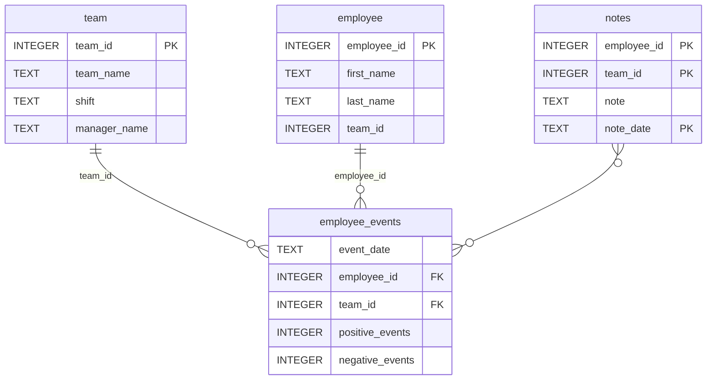

# employee_events

A small Python package for querying the included `employee_events.db` SQLite
database. The `Employee` and `Team` classes provide names, event counts,
dated notes, and input data for the dashboard's recruitment-risk model.

## Install

With Python 3.11 and a virtual environment active, run from the project root:

```powershell
python -m pip install -e ./python-package
```

This installs the package in editable mode and its dependency,
`pandas==2.2.3`. Installing the root `requirements.txt` already performs this
step. The database is included; no separate database server is needed.

## Use

```python
from employee_events import Employee, Team

employee = Employee()
team = Team()

print(employee.names())       # List of (full name, employee ID) tuples
print(employee.event_counts(1))  # Daily event totals for employee 1
print(team.notes(2))          # Dated notes for team 2
```

Both classes provide these methods:

| Method | Returns |
| --- | --- |
| `names()` | List of (name, ID) tuples |
| `username(id)` | List of tuples containing the selected name |
| `event_counts(id)` | DataFrame of daily positive and negative event totals |
| `notes(id)` | DataFrame with `note_date` and `note` columns |
| `model_data(id)` | DataFrame of positive and negative event totals |

For `model_data`, an employee produces one aggregate row; a team produces
one row per employee with recorded events. This method prepares model inputs;
it does not make predictions.

## Database schema

Adapted from Udacity's project diagram. `PK` means primary key and `FK`
means foreign key. These labels and relationships reproduce the course diagram;
the supplied SQLite database does not enforce these key constraints.
The additional `index` columns are omitted for clarity.



## Build a source distribution

From the project root:

```powershell
cd python-package
python setup.py sdist
cd ..
```

The resulting `.tar.gz` file is written to `python-package/dist/` and includes
this README, the package code, and the database.
